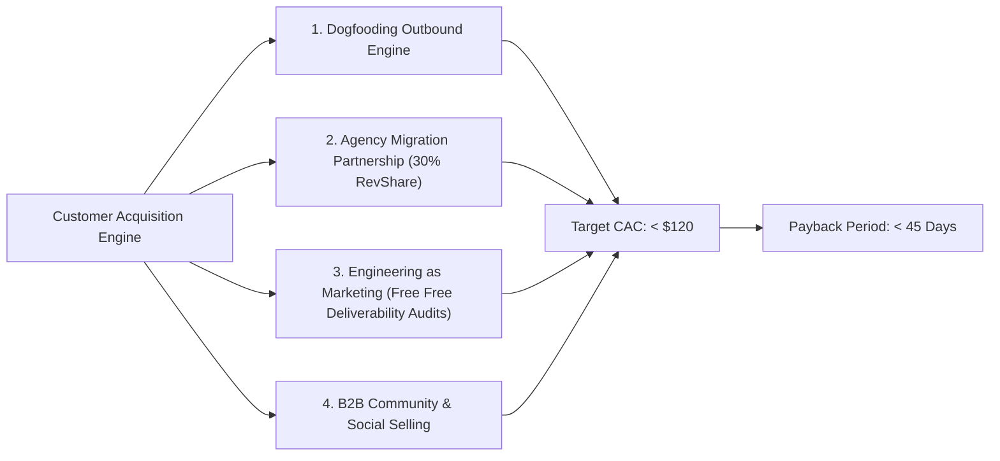
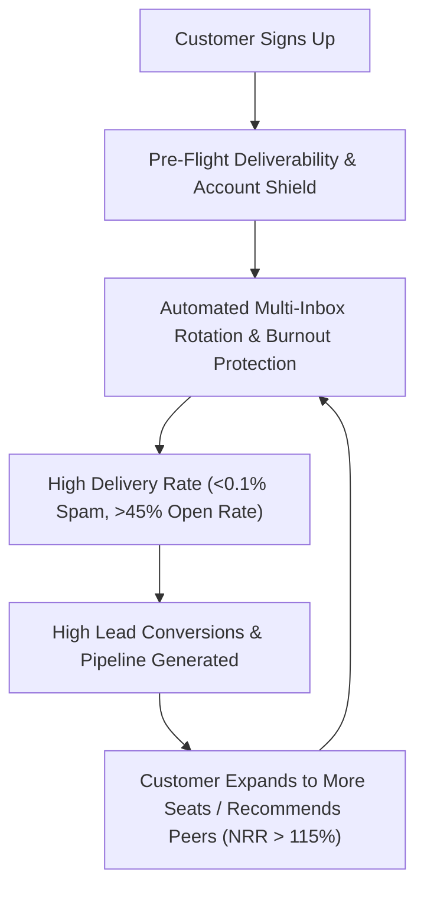

# 🚀 Ele-in Go-To-Market (GTM) Strategy & Commercial Flywheel

**Document Version:** 1.0.0  
**Effective Date:** October 2026  
**Status:** Approved Operational Strategy  
**Ownership:** Founders & Revenue Operations  

---

## 1. Executive Summary: Breaking the "Build Trap"

Ele-in's technical architecture is world-class—boasting multi-account LinkedIn orchestration, distributed worker concurrency, Bayesian ICP scoring, and sub-second deliverability protection. However, software engineering without validated distribution guarantees commercial mortality.

Sales engagement SaaS products face a baseline **15%–20% natural monthly customer churn** driven by client campaign seasonality and outbound mailbox fatigue. To build an enduring, profitable company with ₹50M+ ($600k+) ARR within 18 months, Ele-in cannot rely on passive web hosting. 

This document defines the exact **Target ICP Wedge**, **Unit Economics & Margin Architecture**, **Customer Acquisition Engine (CAC < $120, Payback < 60 days)**, and **Net Revenue Retention (NRR > 115%) Strategy**.

---

## 2. Ideal Customer Profile (ICP) & The Wedge Strategy

Rather than competing head-to-head with generic broad-market sales platforms, Ele-in deploys a **Hyper-Targeted Wedge** against incumbents like HeyReach ($79–$199/seat) and Expandi ($99/seat):

```
                                  THE ELE-IN ICP TARGET PYRAMID
                                              ▲
                                             / \
                                            /   \
                                           / Tier\
                                          /   1   \
                                         /─────────\
                                        /  Tier 2   \
                                       /─────────────\
                                      /    Tier 3     \
                                     /─────────────────\
```

### Tier 1: Outbound B2B Lead Generation Agencies (Primary Anchor — 65% of Revenue)
- **Profile:** 5 to 50 employees managing outbound campaigns for 10 to 40 client companies.
- **Pain Point:** Bleeding $2,000–$6,000/month across fragmented tools (HeyReach for LinkedIn + Smartlead for email + Clay for enrichment). High tool costs compress agency gross margins below 40%.
- **Ele-in Value Proposition:** *"One unified multi-channel engine at 1/3 the cost, with native agency client workspaces, multi-sender rotation, and automatic domain burnout protection."*
- **Target ACV:** $2,400 to $6,000/year (₹20,000–₹50,000/month).

### Tier 2: Seed & Series A B2B Tech Startups ($10k–$100k MRR — 25% of Revenue)
- **Profile:** Founder-led sales or lean 1–2 person SDR teams needing scalable pipeline without hiring expensive SDRs ($75k/year salary).
- **Pain Point:** Lack of technical bandwidth to configure proxies, warmup curves, and multi-inbox rotation. Fear of burning founder LinkedIn accounts.
- **Ele-in Value Proposition:** *"Turnkey outbound infrastructure with bulletproof account safety, pre-flight spam trap guards, and AI personalization that actually converts."*
- **Target ACV:** $1,200/year (₹7,999/month).

### Tier 3: Independent B2B Consultants & Recruiters (10% of Revenue)
- **Profile:** High-ticket service providers needing 10–20 qualified conversations per month.
- **Target ACV:** $588/year (₹3,999/month).

---

## 3. FinOps-Secured Pricing & Unit Economics

To permanently prevent the Negative Gross Margin Death Spiral, all plans enforce hard token context ceilings (max 1,000 prompt tokens, efficient Llama 3.2 11B / Nemotron 3.5 30B models at <$0.22/M tokens) and database-backed atomic credit deductions.

| Tier | Price (INR / USD) | Included Monthly AI Credits | LinkedIn Senders | Email Inboxes | Target Gross Margin |
| :--- | :--- | :--- | :--- | :--- | :--- |
| **Starter** | ₹3,999 / $49/mo | 1,500 credits | Up to 3 | Unlimited | **> 92.4%** |
| **Growth (Most Popular)** | ₹7,999 / $99/mo | 5,000 credits | Up to 10 | Unlimited | **> 94.1%** |
| **Agency Pro** | ₹19,999 / $249/mo | 20,000 credits | Up to 30 | Unlimited | **> 95.8%** |
| **Enterprise Scale** | Custom (₹49,999+ / $599+) | 60,000+ credits | Unlimited | Dedicated Pods | **> 96.5%** |

### Unit Cost Breakdown per 1,000 Outreach Dispatches:
- **LLM Personalization & Scoring (Nemotron-3.5-Lightning-30B):** $0.11 / 1,000 sends
- **Email Infrastructure (SendGrid/SMTP):** $0.40 / 1,000 sends
- **Dedicated Residential Proxy Bandwidth:** $0.65 / 1,000 sends
- **Compute & Database Storage (PostgreSQL Supabase / Render):** $0.14 / 1,000 sends
- **Total COGS per 1,000 Dispatches:** **$1.30**
- **Revenue per 1,000 Credits (Growth Tier):** **$19.80**
- **Net Gross Margin:** **+93.4%**

---

## 4. Multi-Pronged Customer Acquisition Engine (CAC < $120)



### Channel 1: The "Dogfooding" Inbound/Outbound Flywheel
- **Mechanic:** Ele-in runs on Ele-in. We deploy 5 dedicated LinkedIn accounts and 20 warmed secondary email domains targeting agency founders, heads of growth, and SDR leaders.
- **Message Hook:** Show, don't tell: *"We generated 42 agency client meetings last month for $43 in software costs using this exact sequence. Here is the read-only campaign workflow."*
- **Target Volume:** 3,000 prospects reached/month $\rightarrow$ 4.5% reply rate $\rightarrow$ 135 conversations $\rightarrow$ 35 demos $\rightarrow$ **14 new paying customers/month**.

### Channel 2: Agency Migration & RevShare Partner Program
- **Mechanic:** Offer a **30% recurring lifetime affiliate revenue share** to boutique outbound agencies and cold email consultants who switch their clients from HeyReach/Expandi to Ele-in.
- **Incentive:** Free agency white-label portal, unified client switcher, and 1-on-1 dedicated deliverability onboarding.
- **Milestone:** 10 agency partners with an average of 12 client sub-workspaces generates 120 paying customer nodes ($11,880/month MRR) with near-zero direct sales CAC.

### Channel 3: "Engineering as Marketing" (Free High-Utility Tools)
Launch 3 zero-friction, free diagnostic micro-tools that drive viral top-of-funnel inbound traffic:
1. **Free LinkedIn Account Health & Safety Calculator:** Prospects test their account risk score and proxy hygiene before running automation.
2. **Mailbox Deliverability & Spam Trap Scanner:** Free domain DNS (SPF, DKIM, DMARC, BIMI) diagnostic that surfaces burnout risks.
3. **Cold Email Spam Trigger Word Classifier:** Interactive text editor that rates cold email copy against Google/Yahoo 0.3% spam filters.

### Channel 4: Targeted Cold Outbound Benchmarking Content
- Publish forensic, transparent benchmark teardowns: *"HeyReach vs. Smartlead vs. Ele-in: True Cost per 10,000 Verified Connections Analyzed."*
- Distribute across LinkedIn, Twitter/X, and sales communities (RevGenius, Pavilion, SDR Nation).

---

## 5. Retention, Net Revenue Retention (NRR) & Anti-Churn Flywheel

Outbound software churns when campaigns burn domains or get LinkedIn accounts flagged. Ele-in protects retention through systemic architectural guarantees:



1. **The Deliverability Shield (Guaranteed Mailbox Safety):**
   - Automatically pauses outreach when a domain exceeds 0.1% spam complaint rate or 3% bounce rate.
   - Saves customers from the catastrophic cost of blacklisted corporate domains.
2. **Cross-Channel Auto-Halt (Zero Prospect Harassment):**
   - When a prospect replies or unsubscribes, in-flight LinkedIn messages and follow-up emails across all sequences halt in real time.
3. **Usage-Based Expansion (Credit Add-On Flywheel):**
   - Customers scaling campaigns purchase instant top-up credit packs via Razorpay/Stripe, driving expansion revenue that pushes NRR above 115%.

---

## 6. 90-Day Execution Milestones

- **Month 1 (Days 1–30):**
  - Launch internal dogfooding outbound campaigns targeting 500 outbound agency owners.
  - Onboard 5 beta agency design partners at 50% discount in exchange for weekly feedback.
  - Deploy Free Deliverability & DMARC Audit tool as lead magnet.
- **Month 2 (Days 31–60):**
  - Official commercial launch across Product Hunt, LinkedIn, and sales communities.
  - Reach **₹500,000 ($6,000) MRR** with 40 paying customers across Starter and Growth tiers.
  - Activate Agency RevShare Partner Program with first 10 signed affiliates.
- **Month 3 (Days 61–90):**
  - Scale dogfooding outbound to 4,000 prospects/month.
  - Reach **₹1,500,000 ($18,000) MRR** with validated Gross Margins >92% and monthly churn <5%.
  - Initiate SOC 2 Type 1 preparation for mid-market enterprise expansion.
